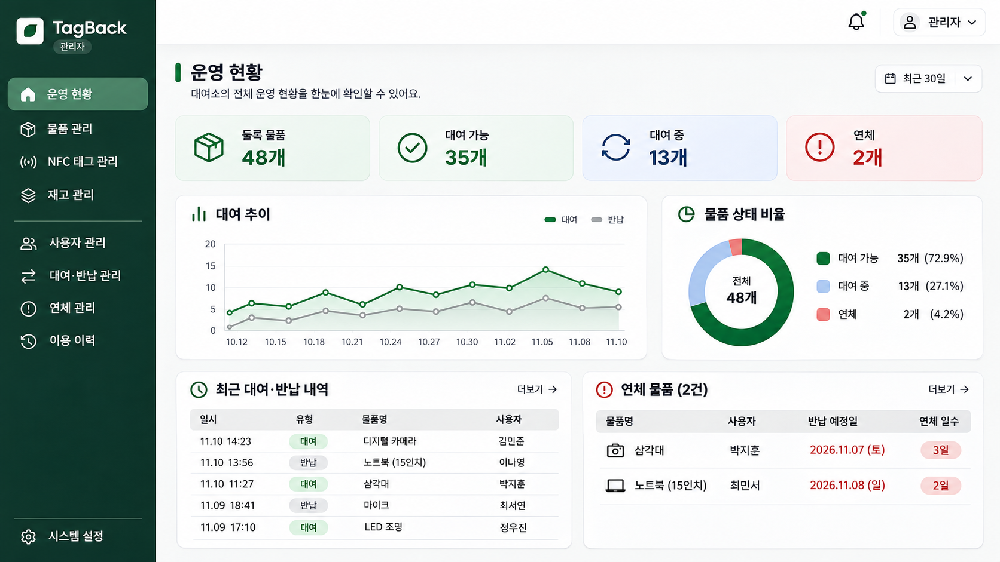
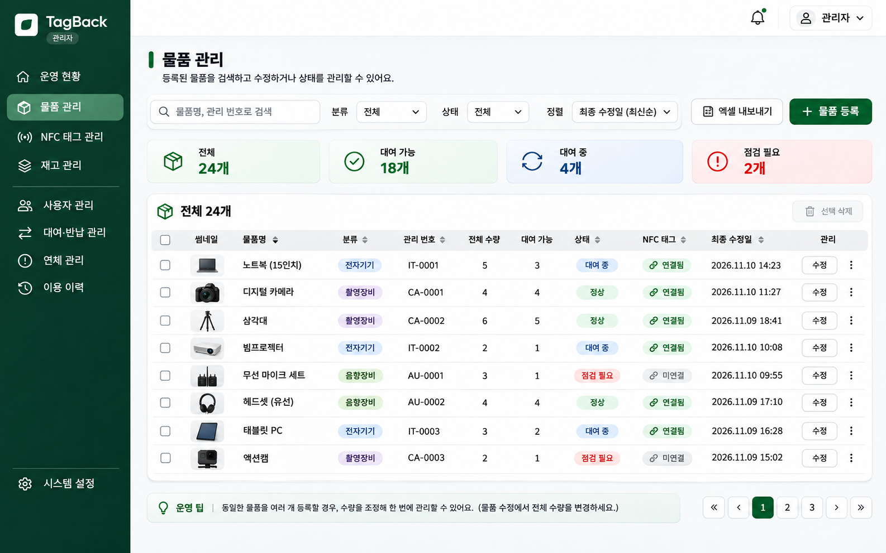
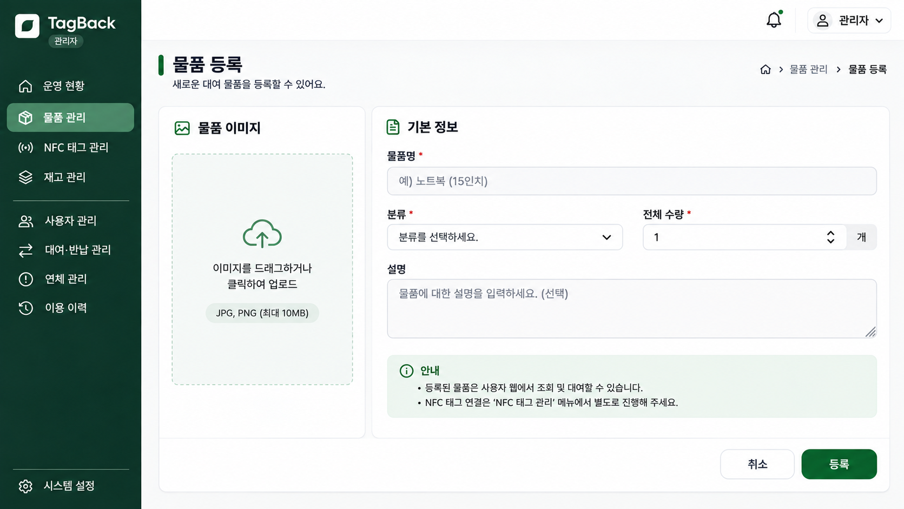
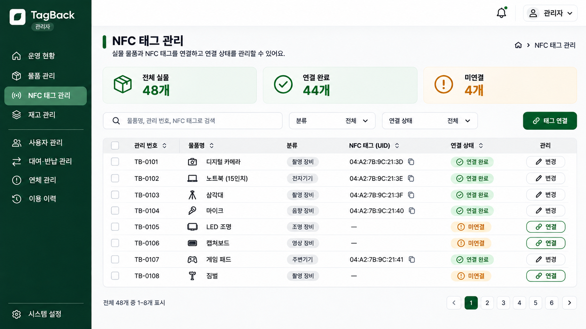
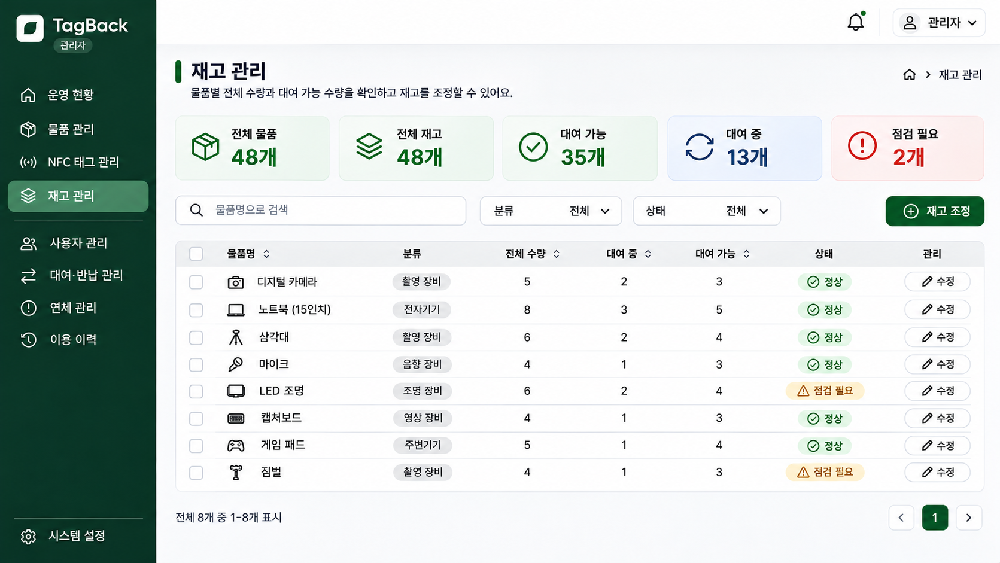
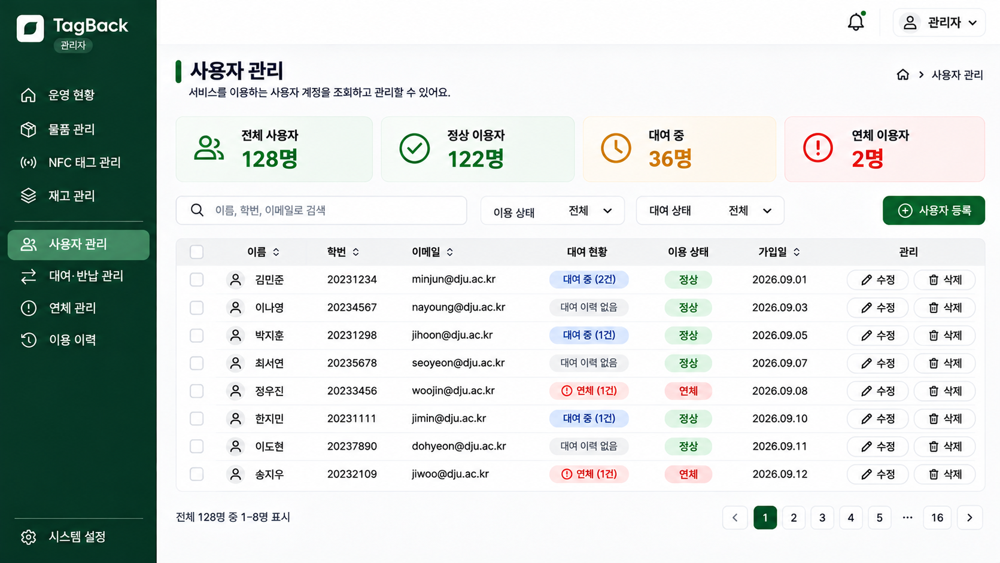
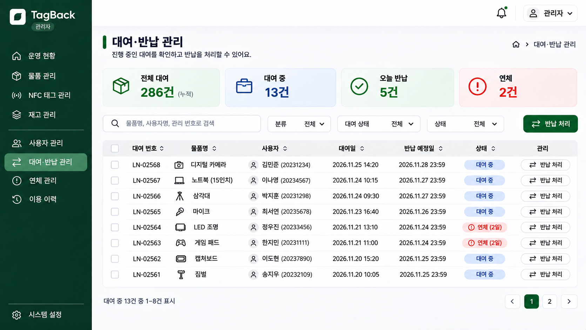
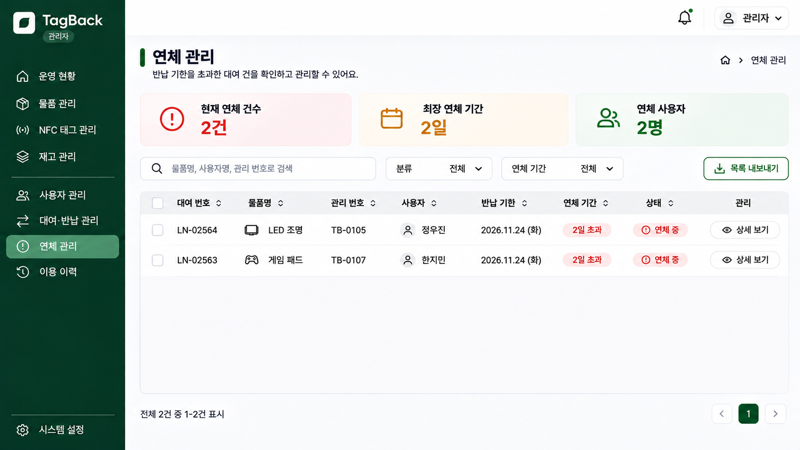
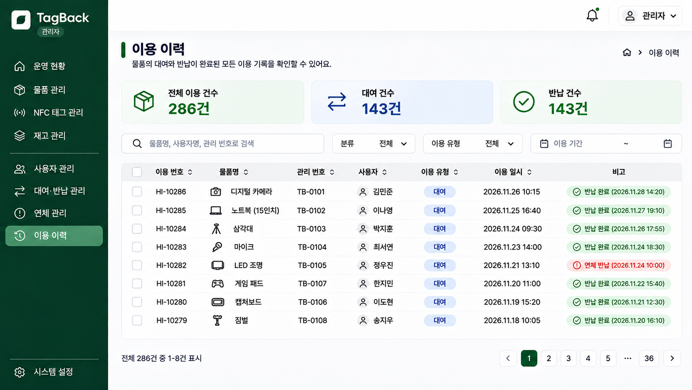

# ADMIN_WEB 화면 명세 v1.1

공통 디자인 시스템, 서비스 요구사항 및 구현 지침을 함께 적용한다. 가상 데이터와 미지원 기능은 실제 구현에 사용하지 않는다.

## AD-01. 운영 현황

**구성 및 동작:** 전체 실물, 대여 가능, 미반납, 연체(미반납에 포함), 최근 대여·반납, 연체 목록, 관련 관리 화면 연결.

**이미지 대비 필수 수정:** 근거 없는 추이/비율 차트 제거; 연체 중복 원형 집계 금지; 기간 필터는 실제 지표에만 적용; 알림 제거.

**검수:** 실제 데이터, 권한, 로딩/빈 데이터/오류 및 키보드 또는 터치 동작을 해당 화면에서 검증.

## AD-02. 물품 관리

**구성 및 동작:** 물품 종류 단위 테이블, 검색/분류/상태/정렬, 전체 및 가능 수량, 등록/수정/삭제. 삭제 확인 및 서버 오류 안내.

**이미지 대비 필수 수정:** 엑셀/일괄 삭제 지원 확인 전 제외; 분류 중립색; 종류별 상태는 실제 집계 기준; 불필요 요약/운영 팁 제거.

**검수:** 실제 데이터, 권한, 로딩/빈 데이터/오류 및 키보드 또는 터치 동작을 해당 화면에서 검증.

## AD-03. 물품 등록 및 수정

**구성 및 동작:** 공통 등록/수정 폼, 기존 스키마에 맞는 물품명/분류/설명/수량 등, 지원 시 이미지, 취소/등록 또는 저장. 수정은 기존 값 로드.

**이미지 대비 필수 수정:** 10MB/파일 형식/필수 필드/수량 방식은 기존 정책; 태그 연결 전에 대여 가능하다고 단정 금지; 수정 별도 이미지 없음.

**검수:** 실제 데이터, 권한, 로딩/빈 데이터/오류 및 키보드 또는 터치 동작을 해당 화면에서 검증.

## AD-04. NFC 태그 관리

**구성 및 동작:** 개별 실물 관리 번호/물품명/분류/태그 식별값/연결 상태/연결 또는 변경, 검색/필터, 전체/연결/미연결 집계.

**이미지 대비 필수 수정:** UID 형식 실제 데이터 기준; 일괄 선택 및 직접 NFC 리더 연결은 지원 확인; 중복 태그 연결은 기존 서버 검증.

**검수:** 실제 데이터, 권한, 로딩/빈 데이터/오류 및 키보드 또는 터치 동작을 해당 화면에서 검증.

## AD-05. 재고 및 물품 상태 관리

**구성 및 동작:** 개별 실물 단위 관리 번호, 물품명, 분류, 대여 상태, 물리적 상태, 상태 변경 및 상세. 검색/필터.

**이미지 대비 필수 수정:** 원본은 종류별 집계 참고용: 개별 실물 행으로 변경; 전체 지표 중복 제거; 점검 필요 주의색; 재고 조정 지원 확인; 상태 변경이 임의 반납을 일으키지 않도록.

**검수:** 실제 데이터, 권한, 로딩/빈 데이터/오류 및 키보드 또는 터치 동작을 해당 화면에서 검증.

## AD-06. 사용자 관리

**구성 및 동작:** 사용자 검색, 실제 수집 정보, 가입일, 대여/연체 수량, 계정 상태, 상세 보기.

**이미지 대비 필수 수정:** 수동 등록 제거; 학번/학교 이메일 임의 추가 금지; 수정/삭제/정지 지원 확인; 계정 상태와 대여 상태 분리.

**검수:** 실제 데이터, 권한, 로딩/빈 데이터/오류 및 키보드 또는 터치 동작을 해당 화면에서 검증.

## AD-07. 대여·반납 관리

**구성 및 동작:** 개별 거래 단위, 검색, 상태/기간 필터, 물품명/실물 번호/사용자/대여일/반납 기한/실제 반납일/상태, 상세 보기.

**이미지 대비 필수 수정:** 직접 반납 및 일괄 처리 제외(지원 확인 전); 학번 제거; 중복 필터 통합; 미반납에 연체 포함.

**검수:** 실제 데이터, 권한, 로딩/빈 데이터/오류 및 키보드 또는 터치 동작을 해당 화면에서 검증.

## AD-08. 연체 관리

**구성 및 동작:** 현재 미반납 연체 건, 검색/분류/연체 기간, 최장 연체 우선, 물품/실물 번호/사용자/반납 기한/기간/상세.

**이미지 대비 필수 수정:** 내보내기 및 체크박스 지원 확인 전 제외; 과도한 테이블 빈 공간 제거; 연체 기간 서버 기준; 독촉/연체료/강제 반납 임의 추가 금지.

**검수:** 실제 데이터, 권한, 로딩/빈 데이터/오류 및 키보드 또는 터치 동작을 해당 화면에서 검증.

## AD-09. 이용 이력

**구성 및 동작:** 과거 완료 거래, 물품/실물 번호/사용자 검색, 기간/분류/반납 상태 필터, 대여일/기한/실제 반납일 별도 열, 상세.

**이미지 대비 필수 수정:** 요약 카드 및 중복 집계 제거; 완료/지연 반납 구분; 이벤트 단위와 거래 단위 혼용 금지; 임의 기록 수정/삭제 제외.

**검수:** 실제 데이터, 권한, 로딩/빈 데이터/오류 및 키보드 또는 터치 동작을 해당 화면에서 검증.
