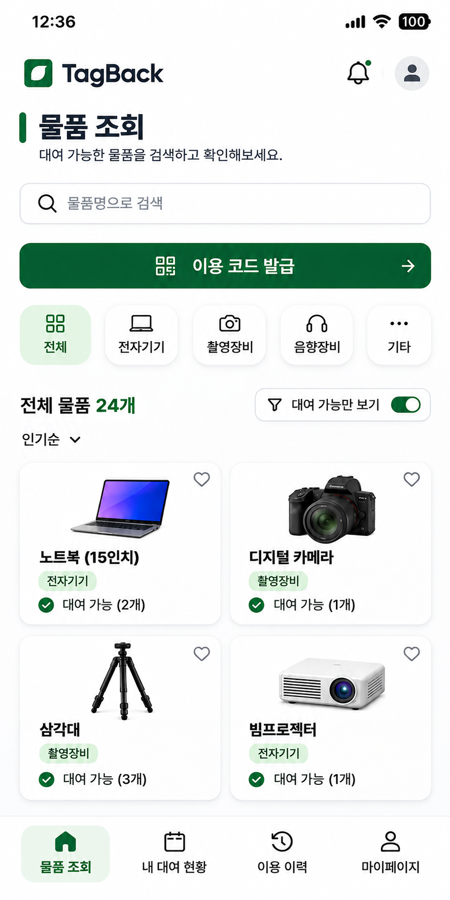
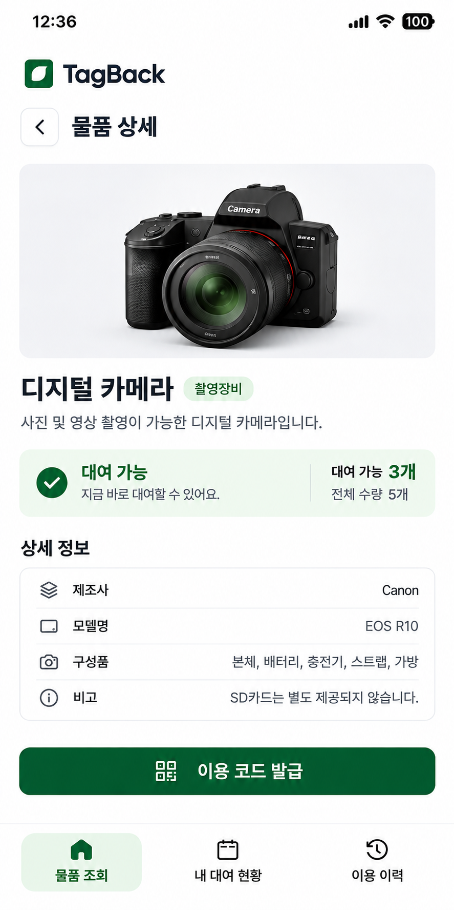
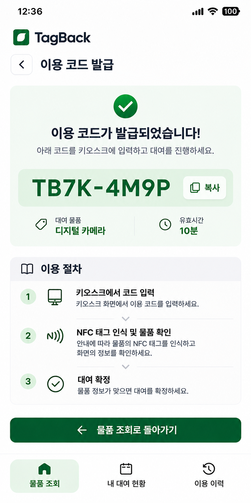
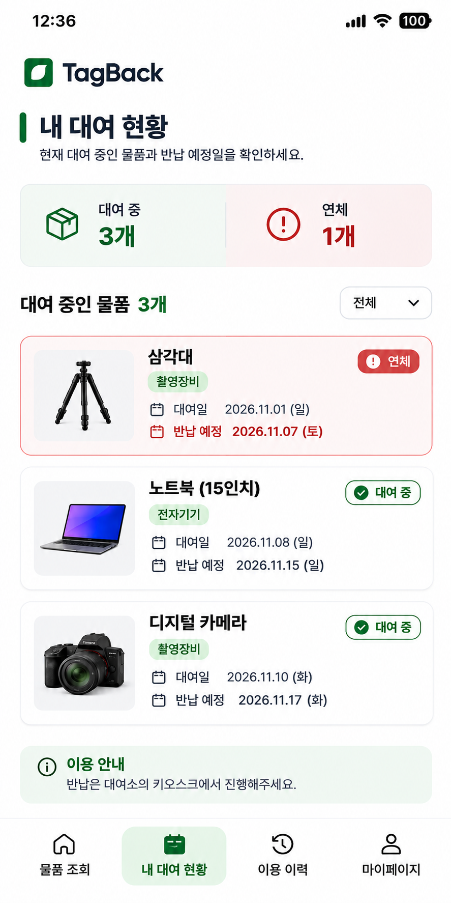
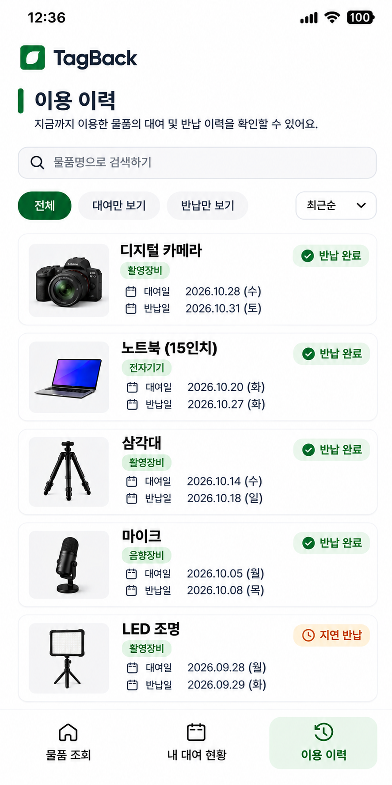
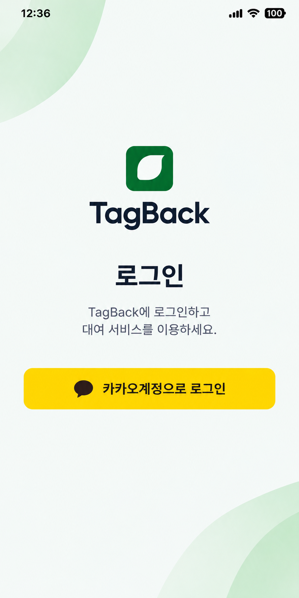

# USER_WEB_MOBILE 화면 명세 v1.1

공통 디자인 시스템, 서비스 요구사항 및 구현 지침을 함께 적용한다. 가상 데이터와 미지원 기능은 실제 구현에 사용하지 않는다.

## MO-01. 물품 조회

**구성 및 동작:** 상단 로고/계정 메뉴, 검색 44px, 통합 코드 버튼 48px, 가로 분류 및 대여 가능 필터, 2열 카드, 하단 3개 메뉴. 카드 전체를 상세 접근 영역으로 사용 가능.

**이미지 대비 필수 수정:** 알림/즐겨찾기/마이페이지/QR 제거; OS 상태 표시줄 구현 금지; 필터 기본 OFF; PC와 재고 일치; 인기순은 지원 확인.

**검수:** 실제 데이터, 권한, 로딩/빈 데이터/오류 및 키보드 또는 터치 동작을 해당 화면에서 검증.

## MO-02. 물품 상세

**구성 및 동작:** 뒤로, 대표 이미지, 이름/분류/설명, 대여 가능/전체 수량, 지원되는 상세 정보, 통합 코드 버튼, 하단 메뉴.

**이미지 대비 필수 수정:** PC와 동일 모델 및 데이터; QR 제거; 분류 중립색; 고정 버튼이 콘텐츠를 가리지 않도록 하단 여백 확보.

**검수:** 실제 데이터, 권한, 로딩/빈 데이터/오류 및 키보드 또는 터치 동작을 해당 화면에서 검증.

## MO-03. 이용 코드 발급

**구성 및 동작:** 현재 통합 코드 36px 권장, 복사, 키오스크 이용 절차, 물품 조회 복귀.

**이미지 대비 필수 수정:** 물품 지정 및 10분 표시 제거(정책 확인 전); 코드 형식 서버 기준; 대여/반납 안내 구분; QR 제외.

**검수:** 실제 데이터, 권한, 로딩/빈 데이터/오류 및 키보드 또는 터치 동작을 해당 화면에서 검증.

## MO-04. 내 대여 현황

**구성 및 동작:** 미반납/연체 요약, 연체 우선 세로 리스트, 물품명/대여일/반납 기한/상태, 키오스크 반납 안내.

**이미지 대비 필수 수정:** 마이페이지 제거; 대여 중 파란색; 분류 중립색; 날짜 및 수량 PC와 동일.

**검수:** 실제 데이터, 권한, 로딩/빈 데이터/오류 및 키보드 또는 터치 동작을 해당 화면에서 검증.

## MO-05. 이용 이력

**구성 및 동작:** 물품명 검색, 기간/반납 상태 필터, 세로 기록 목록, 대여일/반납 기한/반납일, 상태.

**이미지 대비 필수 수정:** 대여만/반납만 이벤트 필터 대신 실제 지원 상태 필터; PC와 동일 데이터; 불필요 요약 제거; 반납 기한 추가.

**검수:** 실제 데이터, 권한, 로딩/빈 데이터/오류 및 키보드 또는 터치 동작을 해당 화면에서 검증.

## MO-06. 카카오 간편 로그인

**구성 및 동작:** 중앙 로고/제목/카카오 공식 버튼, 좌우 24px, 로그인 전 하단 메뉴 없음.

**이미지 대비 필수 수정:** OS 표시줄/장식용 배경/중복 안내 제외; 별도 가입 폼 없음.

**검수:** 실제 데이터, 권한, 로딩/빈 데이터/오류 및 키보드 또는 터치 동작을 해당 화면에서 검증.
