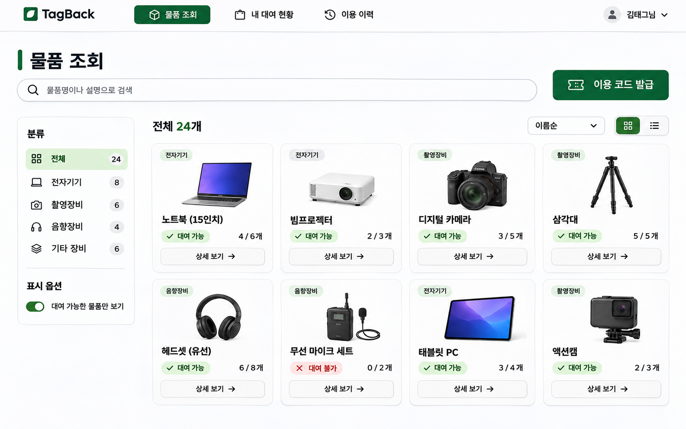
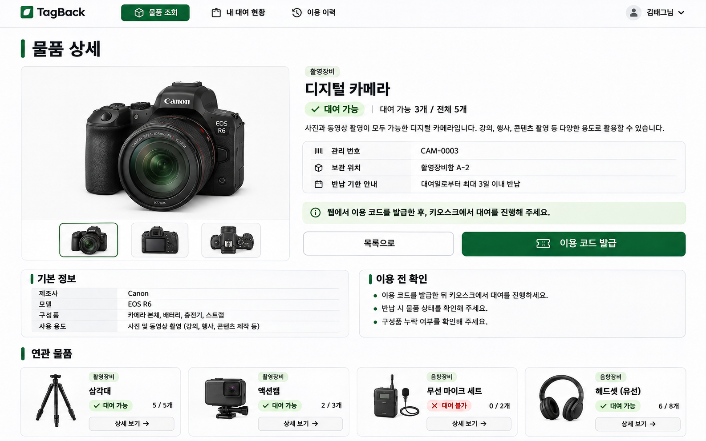
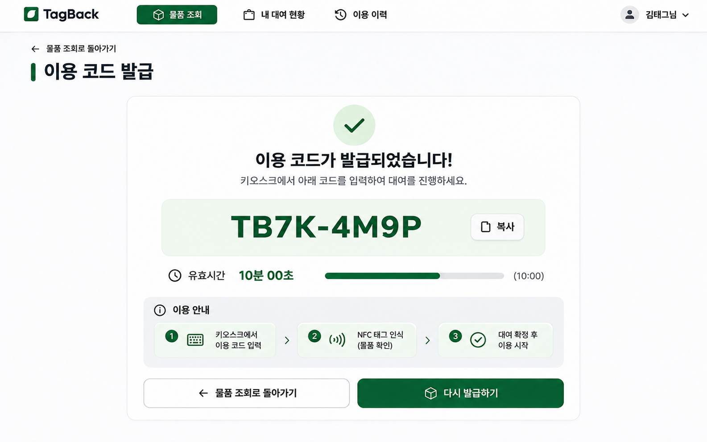
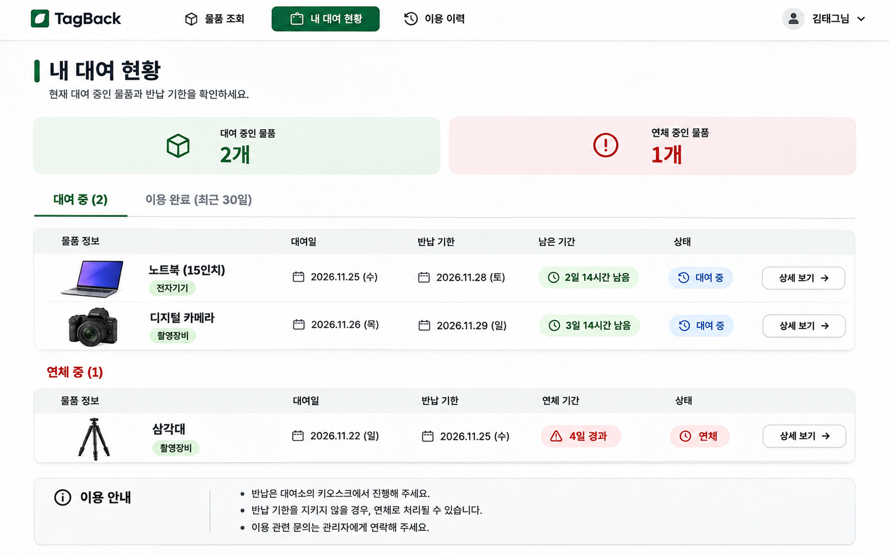
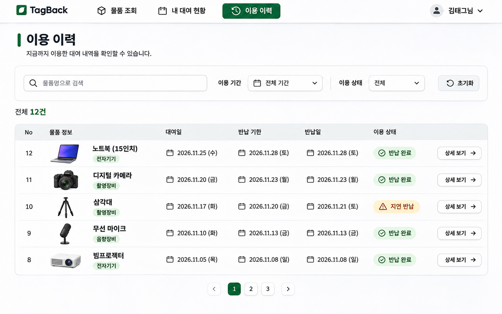
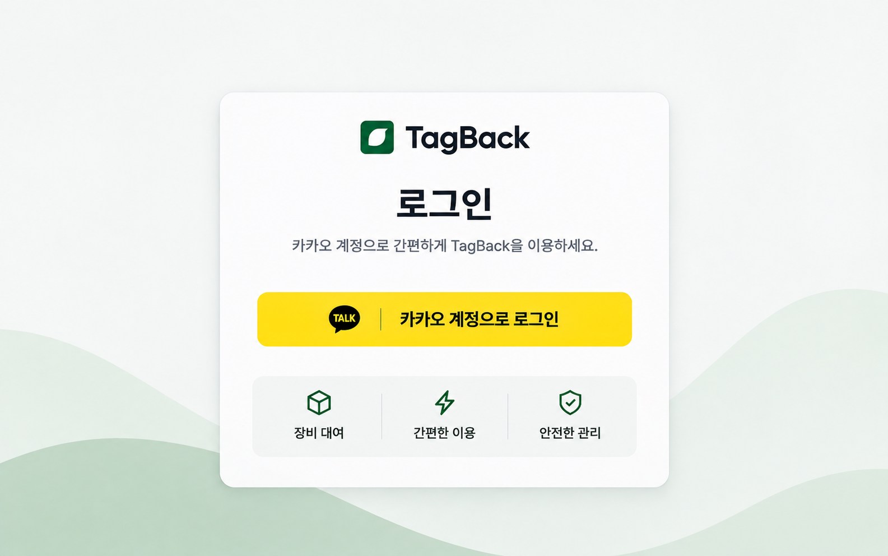

# USER_WEB_PC 화면 명세 v1.1

공통 디자인 시스템, 서비스 요구사항 및 구현 지침을 함께 적용한다. 가상 데이터와 미지원 기능은 실제 구현에 사용하지 않는다.

## PC-01. 물품 조회

**구성 및 동작:** 상단 메뉴, 제목, 검색, 통합 이용 코드 발급, 좌측 분류/대여 가능 필터, 결과 수량, 4열 물품 카드. 카드에는 이미지 또는 대체 아이콘, 분류, 이름, 대여 가능 여부, 가능/전체 수량, 상세 보기.

**이미지 대비 필수 수정:** 필터 기본 OFF; 분류 배지 중립색; 가능/전체 수량 명시; 정렬 및 수량 실제 데이터와 일치. 목록 전환은 지원 시만.

**검수:** 실제 데이터, 권한, 로딩/빈 데이터/오류 및 키보드 또는 터치 동작을 해당 화면에서 검증.

## PC-02. 물품 상세

**구성 및 동작:** 목록으로 돌아가기, 대표 이미지, 이름, 분류, 설명, 재고와 상태, 통합 이용 코드 발급. 상세 필드는 실제 데이터에 한함.

**이미지 대비 필수 수정:** 연관 물품, 다중 이미지, 제조사/모델/구성품/보관 위치, 3일 반납 정책은 지원 확인 전 제외. 코드 발급은 예약 아님.

**검수:** 실제 데이터, 권한, 로딩/빈 데이터/오류 및 키보드 또는 터치 동작을 해당 화면에서 검증.

## PC-03. 이용 코드 발급

**구성 및 동작:** 중앙 최대 560px 영역, 현재 통합 코드, 복사, 키오스크 이용 안내, 물품 조회 복귀. 발급 전/진행/성공/실패 및 서버 지원 시 만료 상태.

**이미지 대비 필수 수정:** 코드 형식, 10분, 타이머, 재발급 정책은 서버 기준. 특정 물품 지정 및 QR 제거. 예시 코드는 실제 코드 아님.

**검수:** 실제 데이터, 권한, 로딩/빈 데이터/오류 및 키보드 또는 터치 동작을 해당 화면에서 검증.

## PC-04. 내 대여 현황

**구성 및 동작:** 미반납 및 연체 수량, 연체 우선 목록, 물품명/대여일/반납 기한/상태, 키오스크 반납 안내.

**이미지 대비 필수 수정:** 미반납 3개 중 연체 1개처럼 포함 관계 명시; 이용 완료 탭 제거; 잔여/연체 기간 서버 기준; 직접 반납/연장 제외.

**검수:** 실제 데이터, 권한, 로딩/빈 데이터/오류 및 키보드 또는 터치 동작을 해당 화면에서 검증.

## PC-05. 이용 이력

**구성 및 동작:** 과거 반납 기록, 물품명 검색, 기간/상태 필터, 대여일/반납 기한/실제 반납일, 반납 완료 또는 지연 반납, 페이지 이동.

**이미지 대비 필수 수정:** 미래 날짜 및 불일치 예시 수정; 분류 중립색; 중복 제목 설명 제거; 현재 대여와 분리.

**검수:** 실제 데이터, 권한, 로딩/빈 데이터/오류 및 키보드 또는 터치 동작을 해당 화면에서 검증.

## PC-06. 카카오 간편 로그인

**구성 및 동작:** 중앙 최대 400px 로그인 영역, 로고, 로그인 제목, 카카오 공식 로그인 버튼, 실패/취소 후 재시도.

**이미지 대비 필수 수정:** 배경 장식, 하단 홍보 영역 제거; 이메일/비밀번호/별도 회원가입/다른 소셜 로그인 제외.

**검수:** 실제 데이터, 권한, 로딩/빈 데이터/오류 및 키보드 또는 터치 동작을 해당 화면에서 검증.
