# WINDOWS_KIOSK 화면 명세 v1.1

공통 디자인 시스템, 서비스 요구사항 및 구현 지침을 함께 적용한다. 가상 데이터와 미지원 기능은 실제 구현에 사용하지 않는다.

## KS-01. 초기 화면

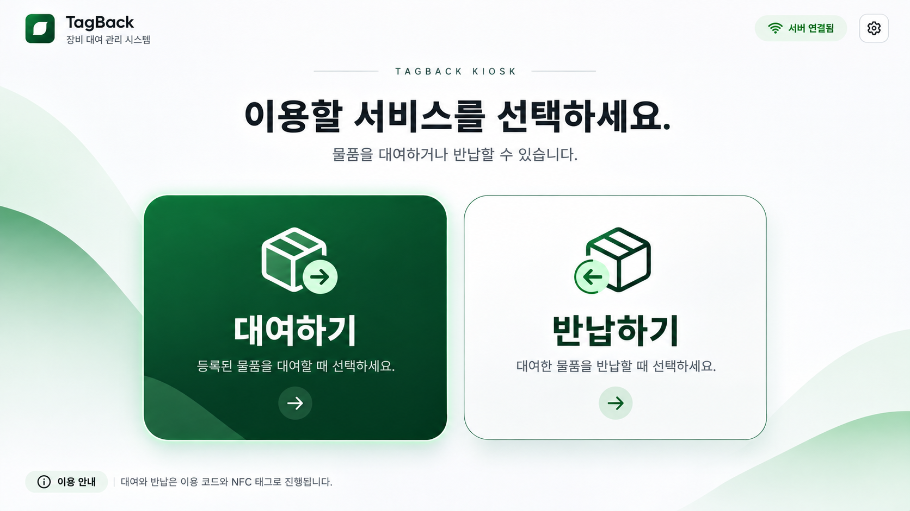

**구성 및 동작:** 대여하기/반납하기 동일 크기와 중요도, 로고, 선택 안내. 대여 KS-02, 반납 KS-06.

**이미지 대비 필수 수정:** 설정/영문 슬로건/과도한 장식 제거; 두 버튼 동일한 강조; 서버 연결 표시는 실제 상태 연동 시만.

**검수:** 실제 데이터, 권한, 로딩/빈 데이터/오류 및 키보드 또는 터치 동작을 해당 화면에서 검증.

## KS-02. 대여 — 이용 코드 입력

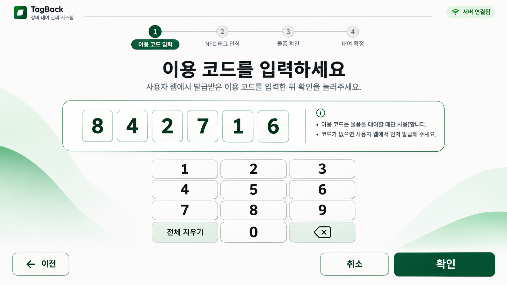

**구성 및 동작:** 대여 1단계, 현재 통합 코드 입력, 형식에 맞는 터치 키패드, 한 글자/전체 삭제, 확인. 성공 KS-03, 실패 KS-11.

**이미지 대비 필수 수정:** 6자리 숫자 가정 금지; 대여 전용이라는 문구 제거; 빈 값 확인 비활성; 코드 검증 중 중복 입력 차단.

**검수:** 실제 데이터, 권한, 로딩/빈 데이터/오류 및 키보드 또는 터치 동작을 해당 화면에서 검증.

## KS-03. 대여 — NFC 태그 인식

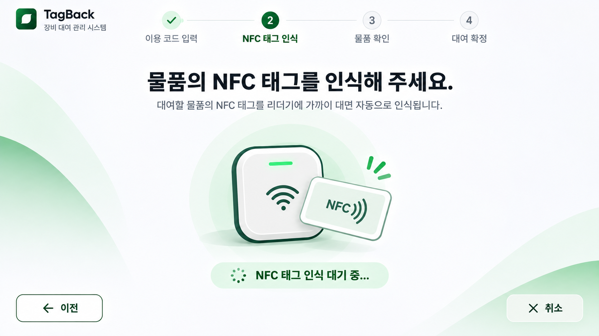

**구성 및 동작:** 대여 2단계, 태그를 리더기에 대는 안내, 대기 상태, 이전/취소. 식별 성공 KS-04, 실패 KS-12.

**이미지 대비 필수 수정:** 실제 리더기 형태 반영; 자동 인식은 실제 연동 기준; 인식만으로 대여 처리 금지.

**검수:** 실제 데이터, 권한, 로딩/빈 데이터/오류 및 키보드 또는 터치 동작을 해당 화면에서 검증.

## KS-04. 대여 — 물품 확인 및 확정

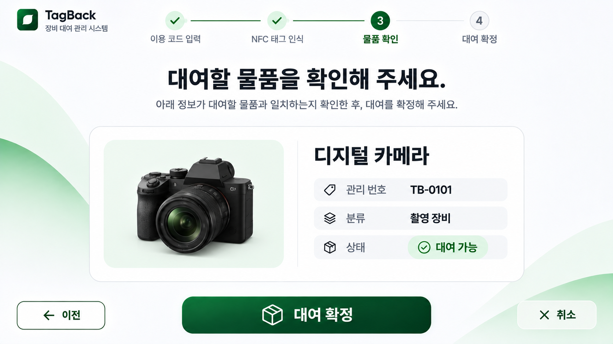

**구성 및 동작:** 대여 3단계 물품 확인, 이미지/이름/실물 번호/대여 가능 상태, 이전/취소/대여 확정. 요청 중 4단계 처리 표시.

**이미지 대비 필수 수정:** 서버에서 대여 가능 재검증; 확정 중 중복 조작 차단; 성공 KS-05, 불명확 KS-13.

**검수:** 실제 데이터, 권한, 로딩/빈 데이터/오류 및 키보드 또는 터치 동작을 해당 화면에서 검증.

## KS-05. 대여 완료

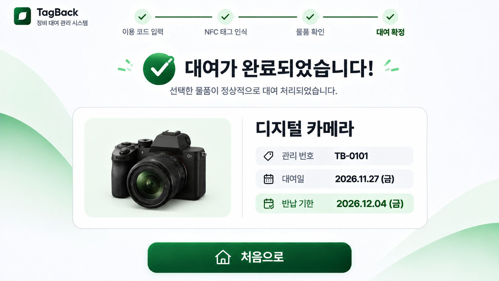

**구성 및 동작:** 모든 단계 완료, 성공 아이콘, 물품/실물 번호/대여일/반납 기한(지원 시), 처음으로.

**이미지 대비 필수 수정:** 서버 저장 성공만 완료; 예시 7일 정책 고정 금지; 자동 복귀는 기존 지원 시만; 사용자 세션 초기화.

**검수:** 실제 데이터, 권한, 로딩/빈 데이터/오류 및 키보드 또는 터치 동작을 해당 화면에서 검증.

## KS-06. 반납 — NFC 인식 및 식별

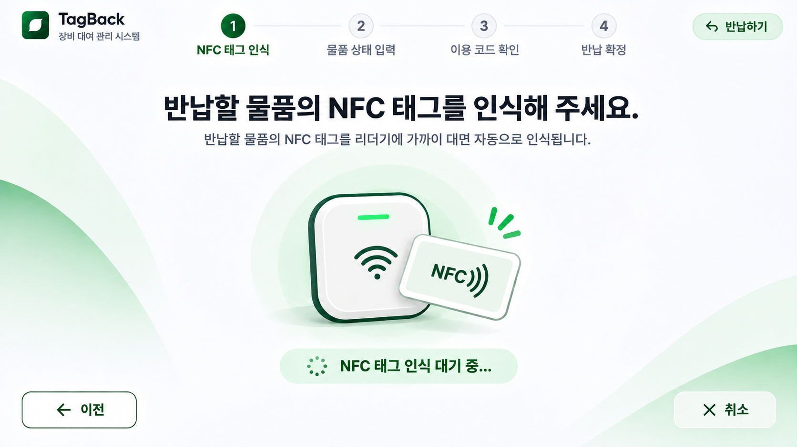

**구성 및 동작:** 반납 1단계, NFC 안내 및 대기, 이전/취소. 식별 성공 KS-07, 실패 KS-12.

**이미지 대비 필수 수정:** 이용 코드 선입력 금지; 진행 중 모드 전환 제거; 인식만으로 재고 변경 금지.

**검수:** 실제 데이터, 권한, 로딩/빈 데이터/오류 및 키보드 또는 터치 동작을 해당 화면에서 검증.

## KS-07. 반납 — 물품 상태 입력

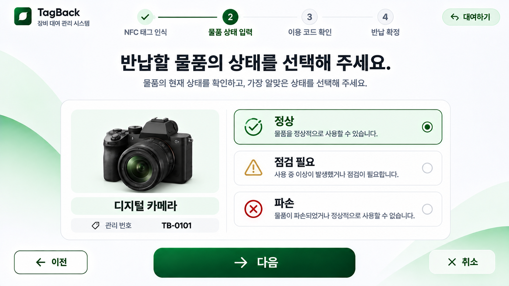

**구성 및 동작:** 반납 2단계, 물품 이미지/이름/실물 번호, 상태 단일 선택, 이전/다음/취소. 선택 후 KS-08.

**이미지 대비 필수 수정:** 기본 선택 없음; 다음 비활성; 정상/점검 필요/파손은 예시, 실제 상태값 사용; 대여 전환 제거.

**검수:** 실제 데이터, 권한, 로딩/빈 데이터/오류 및 키보드 또는 터치 동작을 해당 화면에서 검증.

## KS-08. 반납 — 이용 코드 입력

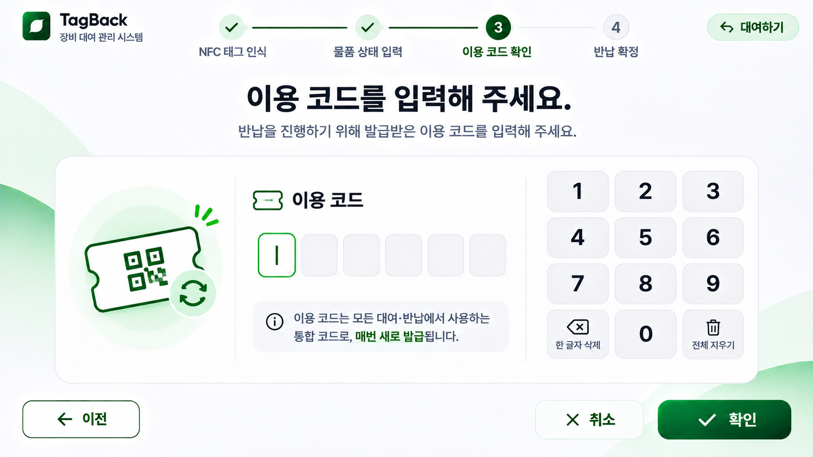

**구성 및 동작:** 반납 3단계, 사용자 웹의 현재 통합 코드 확인, 공통 키패드, 이전/취소/확인. 성공 KS-09, 실패 KS-11.

**이미지 대비 필수 수정:** 이전 대여 코드 요구 금지; QR 및 모드 전환 제거; 코드 길이/형식 서버 기준; 물품별 코드 아님.

**검수:** 실제 데이터, 권한, 로딩/빈 데이터/오류 및 키보드 또는 터치 동작을 해당 화면에서 검증.

## KS-09. 반납 — 정보 확인 및 확정

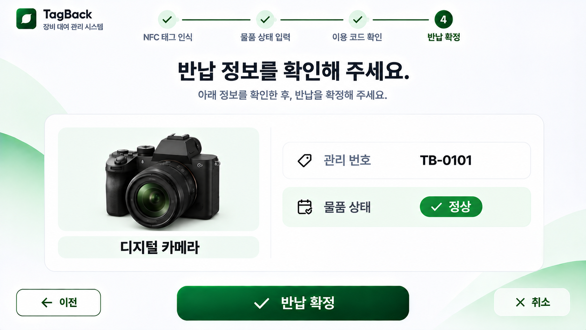

**구성 및 동작:** 반납 4단계, 물품/실물 번호/선택한 상태 확인, 이전/취소/반납 확정.

**이미지 대비 필수 수정:** 코드 자체 미노출; 검증된 사용자와 반납 가능 여부 서버 확인; 처리 중 조작 차단; 성공 KS-10, 불명확 KS-13.

**검수:** 실제 데이터, 권한, 로딩/빈 데이터/오류 및 키보드 또는 터치 동작을 해당 화면에서 검증.

## KS-10. 반납 완료

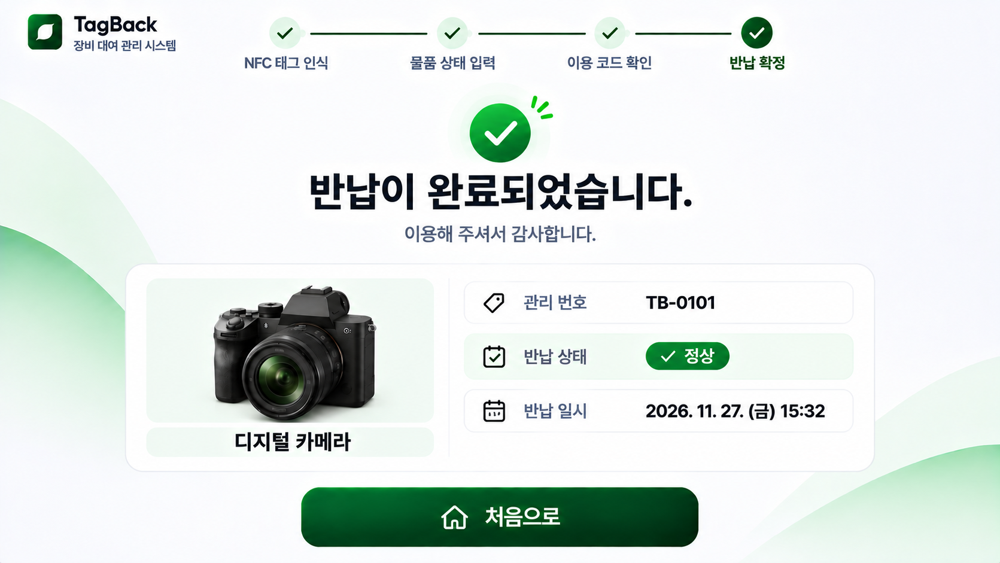

**구성 및 동작:** 모든 단계 완료, 성공 아이콘, 물품/실물 번호/입력한 물품 상태/반납 일시, 처음으로.

**이미지 대비 필수 수정:** 반납 상태라는 레이블은 물품 상태로 변경; 파손이어도 서버 성공 시 반납 완료; 재고 갱신 정책 서버 기준; 세션 초기화.

**검수:** 실제 데이터, 권한, 로딩/빈 데이터/오류 및 키보드 또는 터치 동작을 해당 화면에서 검증.

## KS-11. 이용 코드 오류

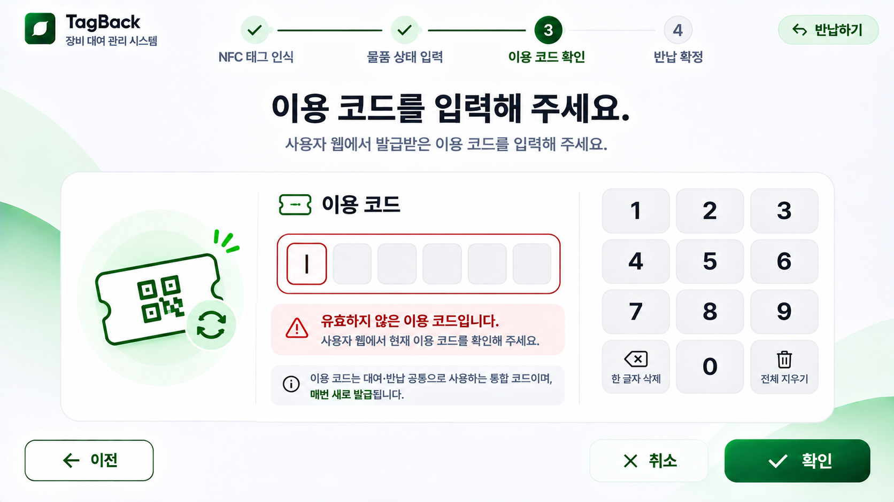

**구성 및 동작:** 기존 코드 입력 화면 유지, 오류 테두리 및 메시지, 현재 코드 확인 안내, 재입력/확인, 이전/취소.

**이미지 대비 필수 수정:** QR 및 모드 전환 제거; 빈 입력 확인 비활성; 검증 실패와 서버 연결 실패 구분; 이전 단계 데이터 유지.

**검수:** 실제 데이터, 권한, 로딩/빈 데이터/오류 및 키보드 또는 터치 동작을 해당 화면에서 검증.

## KS-12. NFC 태그 인식 실패

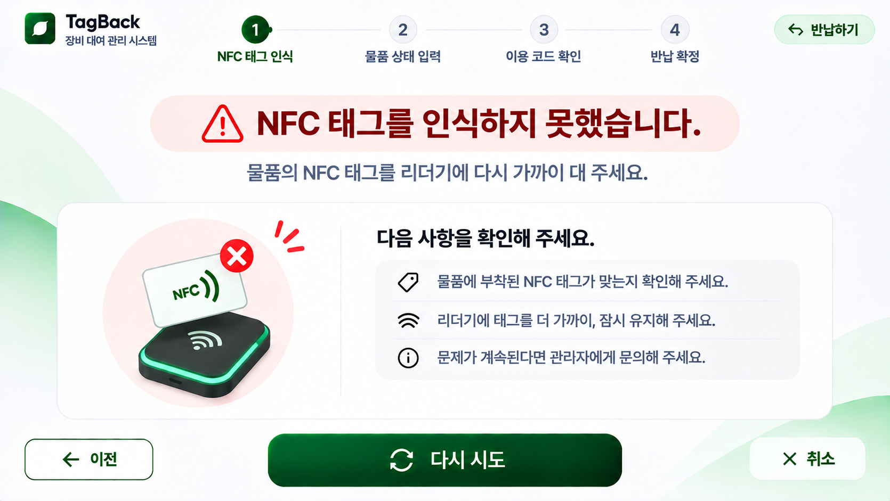

**구성 및 동작:** 기존 인식 단계 유지, 오류 메시지와 실제 리더기 안내, 다시 시도/이전/취소.

**이미지 대비 필수 수정:** 리더기 이미지 통일; 미등록/인식 실패/연결 실패/대여 불가/반납 불가를 실제 오류값에 따라 구분; 모드 전환 제거.

**검수:** 실제 데이터, 권한, 로딩/빈 데이터/오류 및 키보드 또는 터치 동작을 해당 화면에서 검증.

## KS-13. 서버 연결 및 처리 오류

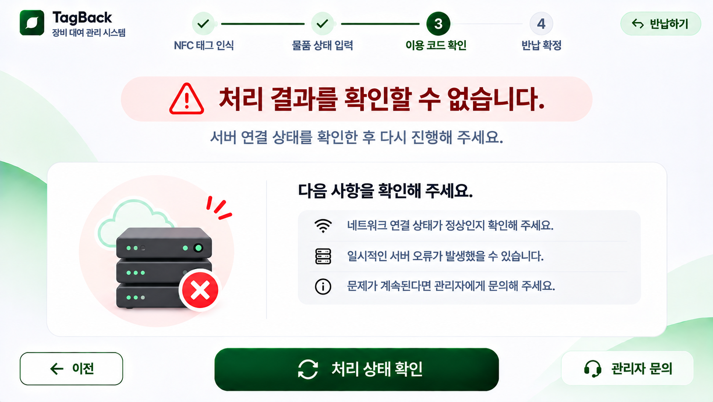

**구성 및 동작:** 요청 전 연결 실패, 저장 실패 확인, 저장 결과 불명확을 구분. 불명확 시 처리 상태 확인(지원 시) 또는 관리자 안내.

**이미지 대비 필수 수정:** 이미지의 이전/모드 전환 제거 또는 제한; 진행 단계 실제 상태와 일치; 다시 거래하라는 문구 금지; 문의 기능 미지원 시 안내 문구; 무조건 재전송 금지.

**검수:** 실제 데이터, 권한, 로딩/빈 데이터/오류 및 키보드 또는 터치 동작을 해당 화면에서 검증.
