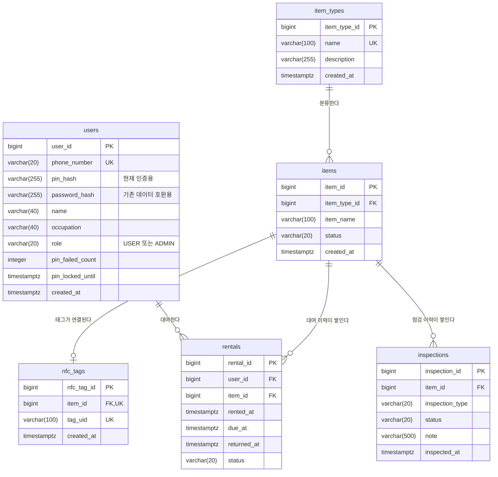
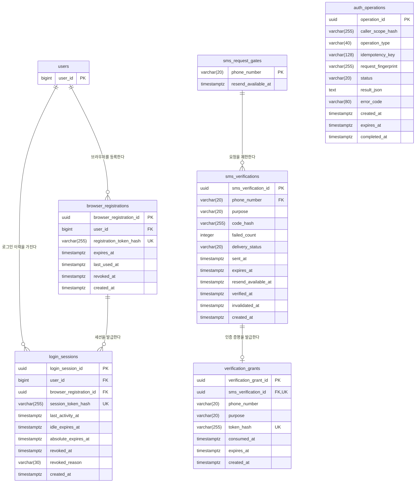

# TagBack 현재 구현 기준 ERD

기준일: 2026-10-08. 백엔드의 Flyway V1~V9를 모두 적용했을 때의 DB 구조를 정리한다. 실제 실행 중인 DB의 적용 상태를 조회한 결과는 아니다.

업무 테이블 6개와 인증 테이블 6개, 총 12개다. Flyway 자체 관리 테이블인 `flyway_schema_history`는 제외한다. 도식의 이름은 실제 DB 테이블·컬럼 이름이며, 날짜 자료형은 모두 시간대를 포함하는 `timestamptz`다. PK는 기본키, FK는 외래키, UK는 고유키를 뜻한다. NULL 허용 여부는 원본 마이그레이션을 따른다.

## 1. 회원·물품·대여·점검

| 테이블 | 간단한 설명 | 현재 구현 수준 |
|---|---|---|
| `users` | 사용자와 관리자를 저장한다. 전화번호를 로그인 식별자로 사용하고, PIN 해시와 역할·이름·직업·PIN 잠금 상태를 관리한다. | 테이블·엔티티·회원 인증 API |
| `item_types` | 계산기·충전기·우산 같은 물품 종류를 저장한다. 한 종류에 여러 개별 물품이 연결된다. | 테이블·엔티티·Repository |
| `items` | 실제 대여되는 물건 하나를 저장한다. 물품 종류와 현재 이용 상태를 관리한다. | 테이블·엔티티·등록·조회·수정·삭제 API |
| `nfc_tags` | NFC 태그 UID와 개별 물품을 연결한다. 물품 하나에 태그를 최대 1개 연결할 수 있다. | 테이블·엔티티·UID 조회 Repository |
| `rentals` | 누가 어떤 물품을 언제 빌렸는지, 언제까지 반납해야 하는지, 실제 반납 시점과 대여 상태를 저장한다. | 테이블·중복 대여 방지 인덱스; 처리 API 미구현 |
| `inspections` | 반납 시 점검이나 관리자 수동 점검의 유형·물품 상태·메모·점검 시점을 저장한다. | 테이블; 처리 API 미구현 |

주요 제약:

- `users.role`: `USER`, `ADMIN`. 기본값은 `USER`다.
- `users.pin_hash`와 `password_hash` 중 최소 하나는 있어야 한다. 현재 회원가입은 `pin_hash`를 저장한다. 기존 비밀번호 해시를 PIN 해시로 변환하지 않는다.
- `users.name`, `occupation`은 DB에서 NULL을 허용하지만 현재 회원가입 서비스는 두 값을 검증해 저장한다.
- `items.status`: `TAG_PENDING` (태그 연결 대기), `AVAILABLE`, `RENTED`, `INSPECTION`, `REPAIR`. `AVAILABLE`은 태그 연결이 필요하다.
- `rentals.status`: `RENTED`, `RETURNED`, `OVERDUE`. 한 물품의 과거 대여 이력은 여러 건 가능하지만, `returned_at IS NULL`인 대여는 최대 1건만 허용한다.
- `inspections.inspection_type`: `RETURN`, `MANUAL`. `inspections.status`: `NORMAL`, `DAMAGED`, `REPAIR`.

## 2. 문자 인증·브라우저 등록·로그인 세션

아래 `users`는 위 도식과 동일한 테이블이며, 연결에 필요한 기본키만 다시 표시한다.

| 테이블 | 간단한 설명 |
|---|---|
| `sms_request_gates` | 전화번호별 문자 재요청 가능 시점을 관리하고 동시 요청을 제어한다. |
| `sms_verifications` | 문자 인증 목적·인증번호 해시·전송 상태·실패 횟수·만료 및 검증 시점을 저장한다. |
| `verification_grants` | 문자 인증 성공 후 발급하는 인증 증명을 저장한다. 가입·로그인·PIN 재설정 등에서 사용하고 소비 여부를 기록한다. |
| `browser_registrations` | 회원이 등록한 브라우저의 토큰 해시·유효기간·최근 사용·폐기 시점을 저장한다. |
| `login_sessions` | 실제 로그인 세션의 토큰 해시·최근 활동·만료·폐기 사유를 저장한다. |
| `auth_operations` | 동일한 인증 요청이 재전송됐을 때 중복 처리하지 않도록 요청 식별 정보와 처리 결과를 저장한다. |

인증 테이블의 실제 FK·고유 제약:

- `sms_verifications.phone_number`는 `sms_request_gates.phone_number`를 참조한다. 회원가입 전 인증도 지원하므로 `users`를 참조하는 FK는 없다.
- `verification_grants.phone_number`는 일반 컬럼이며 전화번호 FK가 아니다. 인증 요청 1건에 인증 증명은 최대 1건이다.
- `login_sessions.user_id`는 `users`를 참조한다. `(browser_registration_id, user_id)`는 `browser_registrations`의 동일한 두 컬럼을 참조하는 복합 FK이며, 다른 회원의 브라우저에 세션이 연결되는 것을 방지한다.
- 회원별 미폐기 브라우저 등록은 최대 1건이다. 등록별 미폐기 로그인 세션도 최대 1건이다. 도식의 1:N은 폐기된 과거 이력을 포함한다.
- 미완료 문자 인증 요청은 `(phone_number, purpose)`당 최대 1건이다. 조건은 `verified_at IS NULL AND invalidated_at IS NULL`이다.
- `auth_operations`는 다른 테이블로 연결되는 FK가 없다. `(caller_scope_hash, operation_type, idempotency_key)` 조합이 고유하다.
- 인증 목적의 DB 허용값은 `SIGNUP`, `LOGIN`, `PIN_RESET`, `PHONE_CHANGE`다. 값이 존재한다는 것이 해당 목적의 API 구현 완료를 뜻하지는 않는다.

## 3. 현재 범위와 초기 ERD의 차이

- 현재 DB는 단일 대여소를 전제로 하며 `rental_stations` 테이블과 `items.station_id`, `rentals.station_id`가 없다. 여러 대여소로 확장하려면 이 구조를 추가해야 한다.
- 현재 `inspections`에는 점검자 FK인 `inspector_id`가 없고, `nfc_tags`에는 태그 활성·비활성 상태 컬럼이 없다.
- 현재 프론트엔드 회원 인증·물품 조회·대여·반납은 mock 저장소를 사용한다. 위 테이블과의 화면 연동은 후속 작업이다.
- 이 문서는 현재 구조를 설명하며 DB 스키마나 API를 변경하지 않는다.

## 원본

- [업무 스키마 및 인증 스키마: Flyway V1~V9](../backend/src/main/resources/db/migration/)
- [회원 엔티티](../backend/src/main/java/com/tagback/domain/entity/User.java)
- [현재 프론트 서비스 저장 로직](../frontend/src/shared/api.ts)
