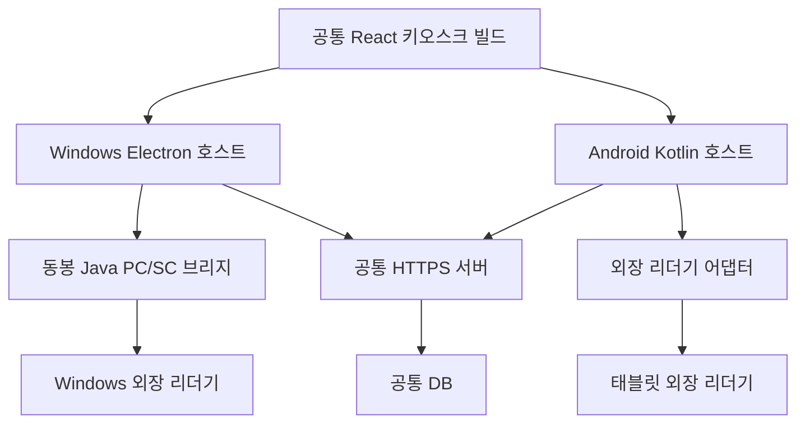

# Windows exe·Android APK 패키징 설계 v1

> 2026-11-13 배포 방식 확정: 공통 서버는 Docker Compose로 실행하고, Windows 설치 파일과 향후 Android APK는 GitHub Releases에서 운영자가 수동 설치·업데이트한다. 앱 자동 업데이트는 현재 범위에서 제외하며 Android 구현 보류는 유지한다. 아래 자동 업데이트 관련 제안은 이 결정으로 대체한다. 자동 실행·연결 복구·관리자 종료는 별도 후속 작업이다. 세부 정책은 [진행 보고서의 확정 배포 및 업데이트 정책](frontend-redesign-progress.md#2026-11-13-확정-배포-및-업데이트-정책)을 따른다.

최신 구현 추가(2026-11-13): 사용자 요청에 따라 P1 및 P2 Windows 시험 골격을 구현했다. [Windows README](../kiosk/windows/README.md)에 실제 산출물·검증·남은 조건을 기록했다. 아래 최초 작성 시점의 설계와 후속 단계는 완료 상태를 의미하지 않는다. P2 main/preload는 변환 단계 없는 CommonJS로 구현했으며 공통 UI의 TypeScript host v2 계약은 그대로 따른다.

작성일: 2026-11-13 (Asia/Seoul). 상태: **구현을 위한 설계 기본안**. 사용자가 확정한 두 설치 앱·공통 서버·외장 리더기 요구를 반영한다. 아래 기술 선택은 이번 설계의 권고이며 사용자 승인이나 구현 완료를 뜻하지 않는다. 이번 작업은 문서화이며 설치 파일 생성·장치 설정·배포를 수행하지 않는다.

## 1. 목표와 기술 선택

| 구분 | Windows | Android |
|---|---|---|
| 설계 대상 | 대여소 노트북/데스크톱, 우선 Windows 11 x64 | Galaxy Tab S10+, 우선 arm64 |
| 앱 호스트 | Electron, TypeScript main/preload | Kotlin Activity + Android WebView |
| 화면 | 동일 React 키오스크 전용 빌드 | Windows와 동일한 키오스크 빌드 |
| NFC | 기존 Java 21 PC/SC 브리지 재사용 | 외장 리더기 SDK/프로토콜을 감싸는 Kotlin 어댑터 |
| 배포 | Electron Forge + Squirrel.Windows 설치용 Setup.exe | release 서명 APK, 초기는 관리자가 직접 설치 |
| Java 런타임 | 필요한 Java 런타임을 앱에 동봉 | Windows JVM/PC/SC를 옮기지 않음 |
| 저장 | 호스트 전용 암호화 작업 기록, Windows 사용자 범위 보호 | 앱 내부 암호화 작업 기록, Android Keystore 키 |
| 운영 잠금 | 전체 화면 + 별도 OS 정책 | 전체 화면 + 관리 장치의 lock task 정책 |

선정 이유: Windows는 기존 TypeScript 화면과 Java 브리지 자산을 유지하면서 프로세스·업데이트를 관리하기 쉽다. Android는 외장 장치 권한·수명주기·운영 모드를 Kotlin 계층에 모으고 화면만 재사용한다. Electron/Chromium와 Java 동봉으로 Windows 크기가 커지는 비용, Android WebView 버전 차이와 별도 Kotlin 유지보수 비용을 수용한다. Tauri나 Capacitor로도 구성할 수 있지만 이번 기본안에 새 Rust 계층이나 추가 플러그인 런타임을 도입하지 않는다.

Electron 보안 설정은 공식 [security](https://www.electronjs.org/docs/latest/tutorial/security) 지침, 설치 산출물은 Forge [Squirrel.Windows](https://www.electronforge.io/config/makers/squirrel.windows)를 따른다. Android의 번들 HTML 로딩에는 [WebViewAssetLoader](https://developer.android.com/develop/ui/views/layout/webapps/load-local-content)를 사용한다. 위 기술 조합 선택 자체는 프로젝트 요구와 코드 검토에 따른 설계 판단이다.

구체적인 Electron/Forge/Android Gradle Plugin/Kotlin/SDK 버전은 골격 구현 때 서로 호환되는 지원 버전을 확인하고 lockfile·Gradle 설정으로 고정한다. 실제 탭의 OS 버전을 확인하지 않은 상태에서 targetSdk나 WebView 최소 버전이 검증됐다고 표현하지 않는다. SDK에 native 라이브러리가 있다면 arm64 ABI 포함 여부를 빌드 입력으로 기록한다.

## 2. 기존 구현에서 달라져야 하는 부분

검토 기준: `codex/user-web-redesign`, HEAD `54cca26`, 제품 구현 `4690e0e`. 2026-11-13 로컬 작업 폴더는 문서 작업 전 clean이었다. 로컬 원격 추적 브랜치도 `54cca26`이지만 이번에 fetch하지 않았다. 과거 미커밋 기록은 현재 상태가 아니다.

| 현재 소스 | 확인 사실 | 패키징 설계 영향 |
|---|---|---|
| `frontend/src/main.tsx` | 사용자/관리자/키오스크를 한 BrowserRouter에서 구성 | 설치 앱 전용 진입점 분리. 사용자·관리자 전체 사이트를 앱에 노출하지 않음 |
| `frontend/src/shared/kioskHttp.ts` | 상대 `/api` URL에 fetch, 대여 grant 사용 | 번들 파일 origin에서 그대로 실행할 수 없음. 키오스크 transport 경계 추가 |
| `frontend/src/kiosk/platform.ts` | host v1의 reader, back, operator, exit 계약 | v1은 유지하고 API·복구·수명주기 계약을 버전 구분해 확장 |
| `frontend/src/kiosk/KioskApp.tsx` | 미확인 쓰기 문맥은 메모리 안에만 존재 | 요청 전송을 호스트가 소유하고 전송 전에 복구 기록 저장 |
| `nfc/reader-bridge` | Java 21, PC/SC, loopback SSE, HMAC proof | Windows에 동봉. 설치 앱용 비공개 IPC 모드 추가 필요 |
| `NfcScanProofVerifier` | 서버가 단일 bridgeId/secret만 신뢰 | 여러 Windows/Android 장치를 독립 등록·폐기할 서버 확장 필요 |
| `RentalReturnService` | 소비된 ticket의 replay는 별도 경로, 서명/nonce/코드 hash/condition 검사 | 기존 replay 의미 보존. 일반 60초 만료를 이유로 성공 결과를 임의 실패 처리하면 안 됨 |
| `AuthOriginGuard`, `AuthCookies` | 웹 origin 검사와 Secure 쿠키 기반 계정 인증 | native HTTP의 운영자 cookie jar 분리, 서버 역할 검사 유지 |

단순히 원격 `/kiosk` URL을 전체 화면에 띄우는 방식 대신 검증한 UI 파일을 설치 파일에 동봉한다. 네트워크가 없어도 오류/복구 안내는 표시하되 대여·반납을 오프라인 완료로 표시하지 않는다.

## 3. 구성과 코드 배치



예정 경로이며 이번 문서 작성으로 아래 디렉터리나 앱이 생성되는 것은 아니다.

```text
frontend/src/kiosk/                  # 현재 화면·상태, 계속 재사용
frontend/src/kiosk-host/             # host schema, web/native transport adapters
frontend/kiosk.html                 # 설치 앱 전용 진입점
frontend/src/kiosk-main.tsx          # 키오스크만 렌더링
kiosk/windows/                      # Electron main, preload, Forge 설정
kiosk/android/                      # Kotlin app, WebView, reader, journal
kiosk/contracts/                    # 버전 있는 JSON schema와 양쪽 contract fixture
nfc/reader-bridge/                   # 기존 PC/SC 코드 + 설치 앱용 IPC 모드
```

설치 UI에는 사용자 웹 로그인·가입·관리자 CRUD 라우트를 포함하지 않는다. 운영자 패널은 종료/장치 진단/설정/업데이트에 필요한 최소 기능이다. 기존 `/mobile`, `/admin`, 웹 개발용 `/kiosk`는 기존 진입점을 유지한다. 신규 kiosk 진입점은 단일 화면 상태로 동작하므로 BrowserRouter의 `/mobile` fallback과 로컬 파일 경로 문제를 피한다.

각 패키지에는 appVersion, uiBuildHash, hostProtocolVersion, journalSchemaVersion, readerAdapterVersion을 기록한다. Windows와 Android가 같은 UI 산출물을 사용했는지 hash로 확인하며 앱 버전과 서버 API 호환 범위도 함께 기록한다.

## 4. Windows exe 구조

- Electron main이 단일 인스턴스, 앱 창, API 연결, 복구 저장소, 운영자 인증, 브리지 자식 프로세스를 소유한다. renderer는 화면과 사용자의 명시적 선택을 담당한다.
- renderer는 `nodeIntegration=false`, `contextIsolation=true`, sandbox 활성화. preload는 허용된 메서드만 노출하고 IPC마다 송신 frame/origin과 입력 schema를 검사한다. 임의 파일·쉘·URL 요청 API를 노출하지 않는다.
- `tagback://app/` 같은 앱 전용 secure/standard custom protocol에서 번들만 제공한다. 경로 이탈을 막고 외부 navigation·popup·다운로드·개발자 도구를 운영 빌드에서 제한한다. CSP는 번들 script와 필요한 최소 리소스만 허용한다.
- 기존 Java 브리지에 stdin/stdout JSON IPC 모드를 추가한다. stdout은 규격 이벤트만, stderr는 자격 증명을 제외한 진단만 기록한다. main이 이벤트를 검증해 preload로 전달한다. 개발용 SSE 모드는 보존하되 설치 앱에서는 불필요한 로컬 HTTP 포트를 열지 않는다.
- 브리지 키는 main의 보호 저장소에서 읽어 자식 프로세스의 비공개 초기화 채널로 전달한다. 명령 인자·일반 환경파일·로그·renderer로 전달하지 않는다. 자식은 키 로딩 후 허용된 실제 리더기 이벤트에만 서명한다. 임의 UID 서명 메서드는 공개하지 않는다.
- Java 런타임은 `jlink`로 구성한다. `java.smartcardio` 및 브리지 실행 모드의 의존 모듈을 분석해 포함하고, 기존 SSE를 함께 배포하면 `jdk.httpserver`도 포함한다. 현장 Java 설치에 의존하지 않는다. 런타임 생성과 패치 책임은 [jlink 문서](https://docs.oracle.com/en/java/javase/21/docs/specs/man/jlink.html)를 따른다.
- 브리지 장애 재시작은 1/2/4/8/16/30초 상한 backoff와 jitter를 기본안으로 한다. 연결 재시도는 허용하지만 업무 쓰기를 자동 재실행하지 않는다. 반복 실패 시 장치 오류를 유지하고 운영자 진단을 제공한다.
- 사용자 로그인 시 자동 실행하며 부팅 전 서비스로 데스크톱 UI를 띄우지 않는다. PC 로그인 자체의 자동화는 현장 OS 운영 정책으로 분리한다.
- 앱 전체 화면과 단축키 제한은 OS 잠금 보장이 아니다. Win32 앱은 현장 Windows 에디션에 맞는 Shell Launcher/제한 정책을 검토한다. [Shell Launcher](https://learn.microsoft.com/en-us/windows/configuration/shell-launcher/)는 에디션 제약이 있고 그 자체로 다른 시스템 접근을 모두 막지 않는다. 일반 Assigned Access 단일 앱 설정을 Electron에 그대로 적용한다고 가정하지 않는다.

설치 산출물 기본안: `TagBack-Kiosk-Setup-<version>-x64.exe`. 설치된 실행 파일, Java 런타임, 브리지, UI 번들을 함께 버전 관리한다. Squirrel 설치 이벤트에서 브리지/운영 창을 중복 실행하지 않도록 처리한다. 조직별 machine-wide 설치가 필수인 경우에는 별도 MSI 요구로 재검토하고 per-user 설치와 혼합하지 않는다.

## 5. Android APK 구조

- Kotlin Activity가 로컬 WebView, 네이티브 API client, 리더기 adapter, 복구 저장소를 소유한다. 동일 Vite kiosk 산출물을 APK assets에 복사해 `https://appassets.androidplatform.net/assets/`로 로드한다. 실제 API는 이 origin의 상대 `/api`가 아닌 호스트 HTTPS client가 담당한다.
- WebView message bridge는 앱 asset origin과 main frame만 허용한다. 외부 페이지/iframe을 허용하지 않고 모든 메시지에 protocolVersion, requestId, action, payload schema를 검증한다. 원시 `addJavascriptInterface`에 광범위한 권한을 노출하지 않는다. [Android native bridge 지침](https://developer.android.com/privacy-and-security/risks/insecure-webview-native-bridges)을 적용한다.
- 사용자에게는 외장 리더기 접촉을 안내한다. 태블릿 내장 NFC·카메라·QR 흐름으로 바꾸지 않는다.
- 리더기 지원 여부 재조사는 생략한다. 실제 어댑터 구현 시 필요한 **연결 방식(USB/Bluetooth 등), 제조사 SDK·호출 규격·재배포 조건**은 입력 자료로 받아야 한다. 기존 Windows 문서의 ACR1552U 이름을 사용자의 Android 장치 모델로 단정하지 않는다.
- USB 연결이면 [USB host](https://developer.android.com/develop/connectivity/usb/host)의 장치 발견·권한·분리 이벤트를 adapter가 처리한다. USB API 사용만으로 특정 리더기 프로토콜 구현이 끝나지 않는다. Bluetooth라면 해당 SDK와 권한 경로를 adapter 내부에서 대체한다.
- 연결/권한 대기/태그 읽기/제거/분리 이벤트를 공통 계약으로 변환한다. 거절·분리 상태에서는 스캔 진행을 막고 재연결 동작을 제공한다. UI thread에서 장치 I/O를 수행하지 않는다.
- 회전은 현재 거래를 재전송하지 않는다. Activity/WebView 재생성은 호스트 상태 snapshot을 받아 표시하고, 프로세스 재시작은 영구 복구 기록을 먼저 확인한다. 백그라운드 복귀 시 서버 연결·현재 시각·권한을 갱신한다. 절전 동안 60초 증명 시간을 멈추지 않는다.
- 기본 거치는 가로, 태블릿 화면 크기 변화에는 기존 반응형 UI를 유지한다. 방향 잠금은 현장 결정으로 남기고 시험 빌드에서 가로·세로를 모두 검증한다. 화면 유지와 부팅 후 실행 정책은 단말 운영 모드에 맞춰 구현한다.
- 초기 APK 수동 설치는 OS 권한 확인이 필요하며 무인 설치·부팅 후 강제 실행·종료 방지를 보장하지 않는다. 상시 무인 운영은 DPC/EMM 관리 장치와 allowlist된 [lock task mode](https://developer.android.com/work/dpc/dedicated-devices/lock-task-mode)를 사용한다. 화면 고정과 관리 장치 lock task를 구분한다. 현장 단말을 무단 초기화하거나 device owner로 등록하지 않는다.

산출물 기본안: `TagBack-Kiosk-<version>-release.apk`, 개발용은 별도 applicationId/서명 사용. release applicationId는 서명 키와 함께 최초 배포 전 확정한다. 이후 업데이트는 동일한 서명 계보와 증가한 versionCode로 배포하며 키는 저장소에 두지 않는다. [Android 앱 서명](https://developer.android.com/studio/publish/app-signing) 절차를 따른다. Play 배포/AAB는 현재 요청 범위가 아니다.

## 6. 공통 호스트 계약과 서버 통신

v1의 reader/back/운영 진입은 유지한다. 설치 앱의 거래 transport를 제공할 때는 host v2 또는 명시적 capability 협상을 추가한다. 필요한 계약이 없는 앱에서 단순 웹 fetch로 조용히 fallback하지 않고 호환성 오류를 표시한다.

| 계약 초안 | 역할 |
|---|---|
| `getCapabilities()` | 호스트/프로토콜 버전, 연결 종류, 기능 제공 여부 |
| `getSnapshot()` | 시작/복귀 시 연결·현재 작업·복구 필요 상태 |
| `subscribeEvents()` | reader, removed, connectivity, lifecycle, operation 변경 |
| `verifyCode`, `catalog`, `scan` | 허용된 키오스크 조회·인증 작업 |
| `commitRental`, `commitReturn` | 호스트가 기록과 서버 전송을 소유하는 명시적 확정 |
| `recoverOperation(operationId)` | 고정 문맥의 결과 조회 또는 정확한 replay |
| `openOperatorPanel`, `requestExit` | 호스트에서 실제 권한 확인, 종료 가능 상태 검사 |

이는 메서드 수준 설계이며 현재 구현된 API가 아니다. public 웹은 기존 fetch adapter, 설치 앱은 native adapter를 사용하도록 `kioskHttp`의 전송 책임을 분리한다. UI 문구·상태는 재사용하고 두 플랫폼이 임의로 업무 규칙을 달리 구현하지 않는다. schema fixture로 요청 필드·응답 판정·오류 분류를 양쪽에 검증한다.

native host는 운영 API origin을 등록 시 고정하고 허용 action→method/path를 내부 매핑한다. renderer가 URL·Authorization·Cookie·임의 헤더를 지정하지 못하게 한다. 일반 업무에는 운영자 cookie를 사용하지 않는다. grant/proof/티켓의 실제 값은 호스트가 보관하고 UI에는 필요한 표시 정보와 불투명 handle만 제공하는 것을 목표로 한다. 기존 `Grant.token` 모델과 API adapter를 이 경계에 맞게 변경하는 작업이 필요하며 지금 이미 숨겨져 있다고 가정하지 않는다.

모든 통신은 운영 HTTPS 인증서 검증을 유지한다. 앱 설치만으로 CORS나 인증을 해제하지 않는다. native HTTP는 웹 CORS 적용 대상은 아니지만 서버 인증·인가와 입력 검사는 그대로 적용된다. 현재 AuthOriginGuard는 Origin이 없는 요청에서 cross-site Fetch Metadata를 검사한다. 운영자 native 로그인은 이 계약을 검증하고, 브라우저 Origin을 위조하거나 전역 allow-all을 추가하지 않는다. origin 정책이 바뀌면 전용 native 인증 계약을 마련한다.

서버 주소·장치 ID·대여소 매핑은 설치 후 등록 설정이며 운영 키나 주소를 사용자가 일반 화면에서 바꿀 수 없게 한다. 개발/시험/운영 설정을 구분하고, 환경을 바꾸려면 미확인 작업이 없어야 한다. 주소와 조직 소유 package ID의 실제 값은 아직 미정이다.

## 7. 장치 등록과 관리자 인증

현재 단일 bridgeId/secret 환경 설정은 여러 장치 운영의 최종 계약이 아니다. Windows와 Android가 한 키를 복제해 사용하는 방식을 운영 기본으로 삼지 않는다.

서버 확장 기본안: 독립 `deviceId/bridgeId`, platform, stationId, enabled/revoked, keyVersion, key lifecycle. ADMIN이 장치를 등록하고 일회성 등록 자격으로 해당 장치에 키를 전달한다. 등록·폐기·교체는 감사 기록을 남긴다. HMAC proof 필드 의미와 서명 정규화는 유지하되 서버가 bridgeId로 키를 찾도록 변경한다. NFC 서명 키와 결과 조회용 장치 자격은 용도 분리하며 APK/exe에 공통 운영 비밀을 넣지 않는다.

Windows는 [safeStorage](https://www.electronjs.org/docs/latest/api/safe-storage)의 사용자 범위 보호를 이용해 키/저널 암호화 키를 감싼다. Android는 [Keystore](https://developer.android.com/privacy-and-security/keystore)를 사용한다. 서버와 공유하는 HMAC 키는 서버가 아는 키를 안전하게 provisioning/import해야 하며, 단말에서 생성한 비수출 키만으로 기존 서버 HMAC을 검증할 수 있다고 가정하지 않는다. 하드웨어 보호 여부는 실물 확인 대상이다. 두 방식 모두 침해된 OS나 권한 있는 로컬 공격을 완전히 방어하는 것은 아니다.

운영자 패널은 공통 서버 계정/PIN으로 로그인하고 서버 세션의 ADMIN을 확인한다. 세션은 호스트의 별도 메모리 cookie jar에만 유지하고 패널 종료/유휴 만료 시 제거한다. 앱 로컬 공용 종료 PIN을 관리자 계정 대체 수단으로 만들지 않는다. 업데이트·주소 변경·장치 등록 같은 민감 동작에는 최근 서버 재인증을 요구하는 계약을 추가한다. 네트워크가 끊기면 앱 내 ADMIN 검증은 실패 상태를 유지하며 현장 OS 관리자 복구 경로를 별도로 안내한다.

미확인 작업이 있으면 ADMIN이라도 단순 '초기화하고 종료'를 허용하지 않는다. 결과 확인과 감사 기록을 통한 해결 경로만 제공한다. OS 강제 종료 자체는 차단 보장 대상이 아니므로 다음 절의 복구가 필요하다.

## 8. 저장·강제 종료·결과 복구

소유자는 React가 아닌 host의 operation manager다. **호스트가 암호화 기록을 내구성 있게 저장한 뒤에만 서버로 쓰기를 전송**한다. 'JS가 전송한 뒤 native가 기록'하는 구조를 금지한다.

```text
IDLE → PREPARED → IN_FLIGHT → CONFIRMED / REJECTED
                         ↘ UNKNOWN → RECONCILING → CONFIRMED / REJECTED / MANUAL_REVIEW
```

- PREPARED: operationId, 종류, 본문 hash, 원래 멱등키/반납 ticket, 필요한 인증 문맥, 시각, schema version을 저장한다. IN_FLIGHT 표시도 네트워크 전송 전에 확정한다. 원자적 저장 실패 시 네트워크 전송하지 않는다.
- IN_FLIGHT/UNKNOWN: 한 장치에서 새 고객 쓰기를 시작하지 못한다. 타임아웃·응답 형식 오류·5xx·재시작을 저장 실패로 단정하지 않는다. 같은 operationId에 다른 본문은 거부한다.
- CONFIRMED: 서버 응답을 검증하고 receipt와 terminal 상태를 저장한 뒤 UI 완료를 표시한다. 반납 예정일/상태는 서버 값을 사용한다.
- REJECTED: 해당 작업이 저장되지 않았다는 명확한 응답을 확인한 경우만 수정 가능하다. 이전 UNKNOWN 뒤 단순 토큰 만료는 REJECTED가 아니다.
- 시작 시 미완료 기록을 읽고 복구 화면으로 들어간다. 이미 확정된 이전 고객 정보는 노출하지 않고 민감 문맥을 제거한다. terminal 저장 직후 crash도 중복 처리하지 않는다.

현재 기존 API만으로는 모든 재시작 시점의 결과 판정을 보장할 수 없다. 대여의 기존 grant/키 replay와 반납 ticket/proof/코드 replay를 우선 보존하며, 만료한 신규 proof를 임의 생성해 원래 반납 요청에 섞지 않는다. 과거 소비된 반납 ticket replay는 서버가 별도 검증하므로 일괄 60초 실패 판정도 하지 않는다.

운영 배포 전 서버에 **장치 인증된 operation 조회·해결 계약**을 추가하는 것을 기본안으로 한다. 예시 `GET /api/v1/kiosk/operations/{operationId}`는 제안 이름이며 현재 존재하지 않는다. 신규 쓰기에 장치/operation을 결합하고 업무 트랜잭션과 동일 커밋 안에 결과를 기록해야 한다. 반납에도 작업 연결 정보가 필요하며 기존 코드의 replay 의미를 바꾸기 전에 계약/마이그레이션 테스트를 작성한다.

조회 응답은 COMMITTED(receipt), REJECTED, PROCESSING, NOT_FOUND 등으로 구분하되, **NOT_FOUND만으로 재발급/새 요청을 허용하지 않는다**. 요청이 아직 도착할 수 있기 때문이다. 안전한 미전송 판정 또는 서버의 원자적 재시도/해결 계약이 없는 경우 MANUAL_REVIEW를 유지한다. deviceId/operationId만 추측해 다른 장치나 고객의 결과를 읽지 못하게 한다. 이 계약의 서버 구현은 본 패키징 문서로 완료되지 않는다.

민감 코드/grant/proof는 필요한 미해결 작업에 한해 암호화 보존하며 로그·평문 설정·백업에 넣지 않는다. terminal 확인 후 민감 필드를 지우고 최소 감사 메타데이터만 유지한다. 미해결 작업은 시간만으로 지우지 않으며 운영자 해결 정책·보존 기간은 서버 계약과 함께 확정한다. Android 백업/재설치 및 Windows 계정 변경으로 키를 잃으면 저장물을 다른 장치에 재사용하지 않고 재등록·관리자 조사 상태로 간다.

## 9. 설치·업데이트·운영

초기 설치 순서: 서명 패키지 설치 → API 환경 설정 → ADMIN 장치 등록 → 리더기 연결 → 서버/장치 자가 점검 → 운영 잠금 → 시험 대여/반납. 설정 미완료·버전 미호환 상태에서는 이용 시작을 막는다.

Windows 실행 파일/설치 파일은 [Authenticode 서명](https://www.electronforge.io/guides/code-signing/code-signing-windows)과 timestamp 적용을 기본으로 한다. 서명이 SmartScreen 경고 제거를 보장한다고 표현하지 않는다. 배포에는 Setup.exe뿐 아니라 업데이트용 RELEASES/nupkg, checksum, 릴리스 노트, 라이선스 목록, 구성 버전 manifest를 보존한다. Squirrel/autoUpdater 경로는 [Electron 업데이트 문서](https://www.electronjs.org/docs/latest/tutorial/updates)를 따른다.

업데이트 다운로드와 설치 시점을 분리한다. 초기는 운영자가 검증된 서명 패키지를 직접 설치한다. 자동 업데이트는 신뢰한 HTTPS 배포 채널·서명 검증·버전 호환 검사와 아래 gate가 구현된 후 켠다. Android 자동 무인 설치는 관리 장치 배포 기능을 통해서만 계획하며 일반 APK에 권한이 있다고 가정하지 않는다.

업데이트/정상 종료 허용 조건: 고객 세션 없음 + host 저널에 미해결 쓰기 없음 + reader 처리 없음 + 운영자 권한 유효. renderer가 'idle'이라고 보낸 값만 믿지 않는다. 다운로드가 끝났어도 미확인 작업 중 강제 재시작하지 않는다.

장애 버전은 기존 배포 중단 후 수정 버전을 높은 versionCode/앱 버전으로 발행하는 roll-forward를 기본으로 한다. Android의 낮은 versionCode 설치나 임의 키 변경을 복구 수단으로 삼지 않는다. 저널 schema는 호환 범위를 선언하고 미해결 작업을 읽지 못하는 버전으로 교체하지 않는다. Electron/Java/WebView/SDK 보안 업데이트도 이 검증과 배포 절차에 포함한다.

진단에는 앱/UI/브리지 버전, 연결 상태, 익명화 operation 식별자, 오류 코드와 시각만 남긴다. PIN·이용 코드·세션 쿠키·grant·서명 키·전체 proof는 남기지 않는다. 서버 운영 도구와 사용자 관리 화면을 키오스크에 그대로 내장하지 않는다.

## 10. 구현 단계와 완료 기준

| 순서 | 작업 | 완료 기준 |
|---|---|---|
| P1 | kiosk 전용 build, host 계약, transport 분리 | 기존 웹/17개 키오스크 fixture 회귀 유지, 번들 단독 실행·버전 불일치 처리 |
| P2 | Windows 시험 exe | 자체 Java 동봉, 단일 인스턴스·비공개 reader IPC·로컬 UI, 개발 PC 외 설치 smoke test |
| P3 | Android 시험 APK | 같은 UI hash, WebView bridge·권한·뒤로가기·재생성 구현, 서명된 시험 APK |
| P4 | host operation manager + 서버 장치/결과 계약 | 전송 전 기록, kill 시점별 복구, 중복 쓰기 0, 장치 간 접근 차단 |
| P5 | ADMIN 운영·서명·자동 실행·업데이트 gate | USER 거부, 패널 종료 시 세션 삭제, 미해결 작업 중 종료/업데이트 금지 |
| P6 | 실물·현장 인수 | 아래 두 기기 실물 시나리오 통과 후 운영 release |

P2/P3 초기 산출물은 시험용이다. P4~P6 없이 무인 운영 완료라고 보고하지 않는다. 현재 장치 사용 불가 상태에서는 P1과 호스트 골격·가상 장치 테스트까지 진행할 수 있다. 하드웨어 검증 없이 실물 어댑터 검증을 통과 처리하지 않는다.

필수 검증: 설치/업그레이드/삭제 후 데이터 정책, 네트워크 단절·DNS/TLS 실패, reader 분리/재연결/권한 거부, 동일 태그 반복, 앱 sleep/회전/백그라운드, PREPARED/전송 직후/서버 커밋 직후/응답 수신 직후 강제 종료, 디스크 쓰기 실패, 키 손실, clock 변경, 일반 USER의 운영 진입, 업데이트 중단, 잘못된 서명/장치 폐기, 실물 정상·손상 반납과 DB 1회 저장. 개발 모드의 mock reader·테스트 키·인증서 예외가 release에 포함되지 않는지도 확인한다.

## 11. 후속 구현에 필요한 입력과 현황

| 입력 | 현재 상태 | 필요한 시점 |
|---|---|---|
| 외장 리더기 연결 방식·제조사 SDK/호출 규격 | 지원은 전제로 함, 구체 자료 미확정 | P2/P3 실물 adapter |
| Windows OS 에디션·운영 계정, 탭 OS/관리 등록 상태 | 미확정 | OS 잠금·부팅 운영·실물 검증 |
| 운영 API HTTPS 주소·장치 수·대여소 매핑 | 실제 값 미확정 | 등록·통합 환경 구성 |
| Windows 코드 서명·Android release 키 관리 주체 | 미확정 | 첫 운영 패키지 배포 전 |
| 앱 ID·배포 경로·업데이트/단말 관리 주체 | 설계 기본안만 있음 | 최초 release 전 |
| 장치 인증·결과 조회·관리자 재인증 서버 계약 | 신규 설계/구현 필요 | P4/P5 운영 준비 |

이 입력들은 설계 문서 작성을 막지 않는다. 다음 작업은 **P1 공통 kiosk 빌드/host 경계 분리 후 P2 Windows 시험 exe 골격**이다. Android 구현은 공통 UI 산출물을 재사용하면서 Kotlin 호스트를 별도로 구성한다.

이번 확인은 소스·문서·공식 기술 문서 검토다. 테스트·빌드·패키징·실물 검증은 재실행하지 않았다. 2026-11-06의 기존 테스트 기록을 새로운 설치 앱의 검증으로 재사용하지 않는다.


## 2026-11-13 P1 구현 반영

P1 공통 kiosk 빌드/host 경계 분리를 구현했다. 구체적인 구현 계약·명령·제약은 [P1 연결 계약](kiosk-host-contract.md), 검증 결과는 [진행 보고서](frontend-redesign-progress.md)를 참고한다. 실제 entry 파일은 기존 `/kiosk`와의 충돌을 피하기 위해 위 제안 경로 `kiosk.html` 대신 `frontend/kiosk-app.html`이다. v2의 `capabilities.transport=1`과 request envelope는 이번 P1 계약이며 native 영구 복구나 운영 권한 구현 완료를 의미하지 않는다. 위 설계의 snapshot/operation manager/장치 등록 및 P2~P6는 후속 범위다.

## 2026-11-13 P2 구현 반영

Windows 시험 호스트·직접 실행 exe·Squirrel Setup.exe 골격을 구현했다. CommonJS main/preload가 host v2 명령을 처리하며 Java 21과 private PC/SC IPC를 동봉한다. 실제 실행과 시험 키 암호화 저장을 검증했다. 최신 검증·산출물은 [진행 보고서](frontend-redesign-progress.md)와 [Windows README](../kiosk/windows/README.md)에 기록했다. 이는 P2 개발 골격이며 타 PC 설치·실물 인수까지 완료한 상태가 아니다. 메모리 보호만 있으므로 P4 영구 복구와 서버 계약, P5 ADMIN·서명·운영, P6 현장 검증 전에 무인 운영하지 않는다. 다음 독립 구현은 P3 Android 호스트/APK 골격이다.
